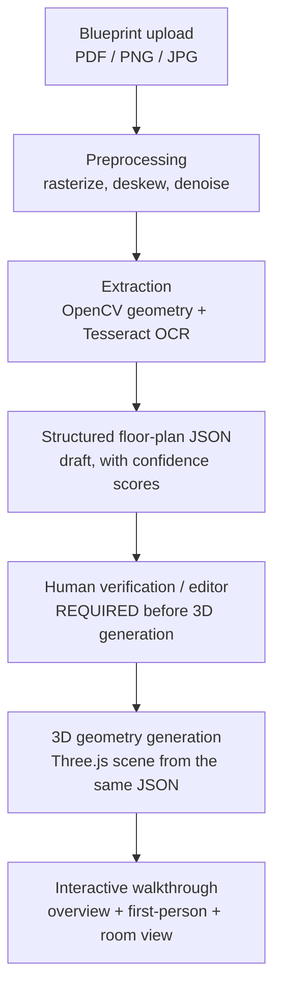

# Blueprint3D — System Architecture

## What this is

Blueprint3D turns a 2D house floor plan (PDF/PNG/JPG) into a walkthrough-ready
3D model, so a construction-company customer can see the house before it's
built. It is a **visualization tool**, not a structural/architectural
drawing generator — see "Product requirement" below.

## Hard constraint

Everything in v1 runs on free and open-source software: no paid APIs, no
paid SaaS, no paid AI services, nothing that needs a credit card. The
codebase is structured so that **paid AI services can be plugged in later
as opt-in upgrades** without changing the rest of the system (see
"Extensibility" below) — but the app must fully work without them.

## Pipeline



Every stage after upload consumes and produces the same
**structured floor-plan document** (see `FLOORPLAN_SCHEMA.md`). The 2D
editor and the 3D engine both read/write that one document — neither has
its own private copy of the floor plan. That's what makes it possible to
replace the blueprint-analysis algorithm later (Phase 11) without touching
the 3D generator (Phase 6-8) at all: they only ever agree on the JSON shape.

## Components

| Component | Tech | Responsibility |
|---|---|---|
| Frontend SPA | React + TypeScript + Vite | Upload UI, 2D floor-plan editor, Three.js/R3F walkthrough, project dashboard |
| API server | Node.js + Express + TypeScript | Auth-free v1 REST API, project/blueprint/floor-plan persistence, orchestrates analysis |
| Blueprint analysis worker | Python (OpenCV + Tesseract), invoked by the API server | Turns a raster blueprint into a *draft* structured floor plan |
| Database | PostgreSQL | Projects, blueprints, floor-plan documents (JSONB), materials, saved camera views |

### Why a Python worker for CV/OCR, when the backend is Node?

The backend web server is Node/Express/TypeScript, full stop — that's not
changing. But `opencv4nodejs` (the Node binding for OpenCV) is a native
addon that's fragile to install and not well maintained. `opencv-python`
and `pytesseract` are the mainstream, well-supported way to do this kind of
work, and both are free/open-source with no API costs. So the plan (Phase
11) is: the Node API shells out to a small, self-contained Python script
per analysis job (stdin: image path, stdout: draft JSON). It's still 100%
free/open-source, still fully local, and it's isolated behind one
interface — see below — so it could become a proper microservice later
without anyone touching the rest of the app.

## Extensibility: where paid AI would plug in later

The analysis step is written against one interface, not a concrete
implementation:

```ts
interface BlueprintAnalyzer {
  analyze(input: { imagePath: string; mimeType: string }): Promise<FloorPlanDraft>;
}
```

Phase 11 ships `HeuristicBlueprintAnalyzer` (OpenCV + Tesseract, the Python
worker above). If a paid, more accurate vision model becomes worth it
later, it becomes a second implementation of the same interface —
`AiAssistedBlueprintAnalyzer` — selected by config/environment variable.
Nothing upstream (upload UI) or downstream (editor, 3D generation) needs to
change, because both only ever see a `FloorPlanDraft`.

## Non-goals for v1

- Photorealistic rendering (Step 11 explicitly deprioritizes this after
  dimensional accuracy, floor plan correctness, room structure, usable
  walkthrough, and performance)
- True CSG boolean geometry for door/window openings — see
  `3D_GENERATION.md` for the segment-splitting approach used instead
- Multi-story houses — the floor-plan schema is single-level for v1; see
  `FLOORPLAN_SCHEMA.md` for how it could extend to multiple levels later
- Authentication / multi-user accounts — v1 assumes a single local user;
  the database schema leaves room for a `users` table so this can be added
  without a rewrite

## Product requirement: the disclaimer

Generated models must never be presented as construction-ready. Once the
walkthrough UI exists (Phase 8-13), it must carry a visible line to that
effect, e.g.: "This visualization is generated from the provided floor
plan and is intended for design visualization. It should not be used as a
substitute for approved architectural or structural drawings." Tracked
here so it isn't lost by the time that screen gets built.

## Where to look next

- `FOLDER_STRUCTURE.md` — the repo layout, tagged by which phase adds what
- `DATABASE_SCHEMA.md` / `FLOORPLAN_SCHEMA.md` — the data model
- `API_DESIGN.md` — the REST surface
- `BLUEPRINT_PIPELINE.md` / `3D_GENERATION.md` — the two hardest pieces, in detail
- `MILESTONES.md` — the phase-by-phase build order and status
